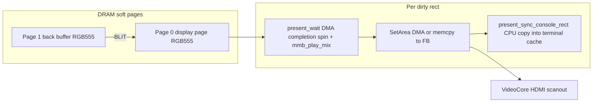
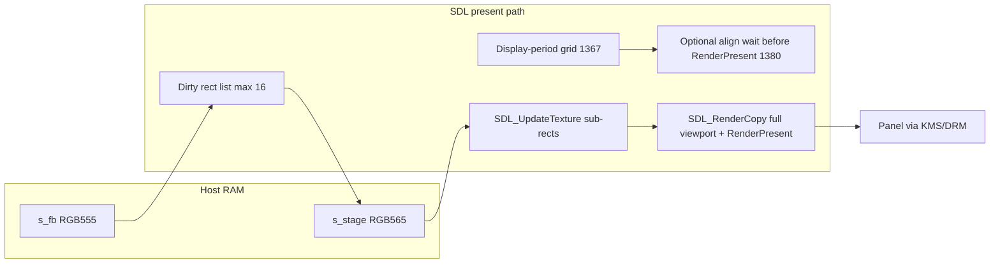

# Pi 400 vs Linux framebuffer (`mmcore-fb`) performance

Analysis for the ~2–3× gap Marnix sees between a **Pi 400** (bare-metal mmcore) and a **Chromebook** running the **Linux framebuffer build** (`mmcore-fb` from the Alpine ISO or `mmcore-fb-linux-x86_64.tar.gz`). Same MMBasic sources in `mmbasic/`; different platform backends and present paths.

## Which build runs where

| Device | Artifact | Backend | How to confirm |
| --- | --- | --- | --- |
| **Pi 400** (also Pi 4B / CM4) | `mmcore-console-pi400-v*.zip` → `kernel8-rpi4.img` on FAT | Circle bare metal, `CBcmFrameBuffer` HDMI via VideoCore property tags | `INSTALL.md` zip table; `scripts/build.sh` with `RASPPI=4` |
| **Pi 3 / Zero 2** | `kernel8.img` (BCM2710) | Same Circle path, older SoC | `mmcore-console-rpi3-v*.zip` |
| **Chromebook / PC (framebuffer)** | `mmcore-fb-x86_64.iso.zst` or `mmcore-fb-linux-x86_64.tar.gz` | Native binary `mmcore-fb`: SDL2 **kmsdrm** video driver, software RGB555 page + dirty-rect upload | `docs/framebuffer-and-iso.md`, `native/Makefile` target `sdl-fb` (`FB=1`, `-DMMB_SDL_FRAMEBUFFER=1`) |
| **Chromebook (ARM)** | Same ISO if x86_64; some ARM Chromebooks use aarch64 builds from source | Same SDL fb path when built with `make -C native sdl-fb` | Not a separate release zip today; behaviour matches `mmcore-fb` |

QEMU CI uses `kernel8.img` with `configure --qemu` (no DMA burst, no virt-offset flip). **Do not treat QEMU timings as Pi hardware.**

Interpreter core, `mmbasic/src/*.c`, and release compiler defaults:

- **Pi**: Circle `OPTIMIZE ?= -O2`, `-mcpu=cortex-a72` (Pi 4/400), AArch64, hard float (`circle/Rules.mk`).
- **Native fb**: `CFLAGS ?= -O2 -g` (`native/Makefile`), host GCC/clang.

No sanitizer or `-O0` on release paths. Fixed-point vs float: same `mmbasic` sources; games like Void Runner use `OPTION DEFAULT INTEGER` with selective `float` arrays.

---

## Per-target pipeline for one visible frame

### Void Runner (representative game)

From `mmcore-apps` `games/voidrunner/includes/screen.inc` and `game.inc`:

1. Logic runs on **page 1** (`PAGE WRITE 1`); sprites updated with `SPRITE NEXT` / `SPRITE MOVE`.
2. Each play frame: `gm.render()` then `scr.flush()` if dirty.
3. `scr.flush()` sets `PAGE WRITE 0` and **BLIT**s each dirty rectangle from page 1 → page 0 (display page), then returns to page 1.
4. Each BLIT to the display page calls `mmb_gfx_dirty_flush()` → `mmb_gfx_present()` → platform present.

So one game tick often produces **several present epochs** (one per dirty rect, plus sprite `present_rect` calls), not a single `PAGE DISPLAY` flip.

### Pi 400 (Circle / HDMI)



Key code:

- Soft pages: `mmbasic/src/gfx.c` (`page_buf`, RGB555).
- BLIT → present: `mmbasic/src/gfx_cmm2.c` (`mmb_gfx_blit_copy` → `mmb_gfx_dirty_flush`).
- Present: `mmb_gfx_present` / `mmb_gfx_present_rect` → `console/platform.cpp` `plat_present_native` → `CBcmFrameBuffer::SetArea` (`circle/lib/bcmframebuffer.cpp`).
- **Console cache reconcile** (Pi only): `plat_present_sync_console_rect` / `present_sync_console_region` copies pixels into Circle’s terminal backing store so the next text row flush does not stomp graphics (`console/platform.cpp` ~1370–1458). **Runs on every partial present**, not only full-screen `PAGE DISPLAY`.
- **DMA wait**: `plat_present_wait` spins until async SetArea completes, calling `mmb_play_mix()` (`console/platform.cpp` ~71–75).
- **Full-frame flip + vsync**: only when `PAGE DISPLAY` sets `present_set_flip(1)` and a full-screen present uses `plat_set_area_flip` (VSync + `SetVirtualOffset`) (`console/platform.cpp` ~87–108, `mmbasic/src/cmd_graphics.c` ~758–775). Void Runner’s incremental `scr.flush()` path does **not** use this flip.

HDMI framebuffer depth is typically **16-bit RGB565** (Circle `DEPTH`); soft pages stay **RGB555** in RAM.

### Chromebook / `mmcore-fb` (SDL KMS/DRM)



Key code:

- Dirty rects + pacing: `native/sdl_video.c` (`sdl_video_mark_dirty_rect`, `sdl_pace_*`, #1367).
- **No** terminal cache sync (no `present_sync_console` on SDL).
- `wait_vsync` platform hook is a **no-op**; pacing is owned by `sdl_video_present()` (`native/platform_sdl.c` ~256–262).
- `VSYNC_WAIT` / flip pacing does not double-wait on fb builds (#1367 / #1380 comments).

Display period uses **monotonic microseconds** and refresh rate from SDL (`sdl_video_frame_period_us`). `PAUSE` still uses **millisecond** `plat_millis()` on both targets (`mmbasic/src/core.c` `mmb_cmd_pause`).

---

## Ranked likely causes

Rough gains are **perceived game speed** (effective FPS or simulation progress), not CPU benchmarks alone. Order is for Void Runner–style partial presents on Pi.

### 1. Multiple HDMI presents + terminal cache sync per game frame (Pi only)

**Evidence**

- `scr.flush()` loops BLITs to page 0 (`screen.inc`); each BLIT to the display page flushes dirty and presents (`gfx_cmm2.c` ~331–336).
- Each `mmb_gfx_dirty_flush()` calls `mmb_gfx_sync_console` for the **full display page** (`gfx.c` ~349–360), which on Pi runs `plat_present_sync_console` → per-pixel `SetRawPixel` over the reconciled region (`platform.cpp` ~1370–1426). Partial presents use `present_sync_console_rect` (same loop, clipped).
- Void Runner: several column strips + ship box per tick (`game.inc` `gm.render` / `scr.mark`).

**Expected gain if fixed**: **~1.5–2.5×** on Pi for this title (merge blits into one present per tick; sync console once per frame or only for text UI).

**Issue ideas**

- Batch display-page BLITs: single dirty union, one `mmb_gfx_present` per BASIC “frame”.
- Defer `mmb_gfx_sync_console` to full-frame presents or explicit `PAGE DISPLAY` only.
- Fast path: bulk memcpy into terminal cache instead of per-pixel `SetRawPixel`.

### 2. Present path CPU/memory cost on Pi (DMA setup, bounce buffers, cache maintenance)

**Evidence**

- `SetArea`: 16-byte alignment requirements; unaligned widths fall back to CPU row `memcpy` (`bcmframebuffer.cpp` ~237–314).
- Non-contiguous stride uses `present_bounce` malloc buffer (`platform.cpp` ~1352–1364).
- Synchronous `SetArea` waits on DMA (`bcmframebuffer.cpp` ~266–267).

**Expected gain**: **~10–25%** after (1); more on high resolutions.

**Issue ideas**

- Pin display-page rows for DMA-friendly alignment at mode set.
- Reuse bounce buffers (already partially pooled for TERM).

### 3. `plat_present_wait` + audio mix in the present hot path

**Evidence**

- Every present waits on `s_present_busy` with `mmb_play_mix()` in the spin (`platform.cpp` ~71–74, `gfx.c` `present_wait_dma`).

**Expected gain**: **~5–15%** when audio idle; higher if JUKE/audio active.

**Issue ideas**

- Mix on a timer IRQ only; block present on DMA flag without full poll stack.

### 4. SDL fb: dirty-rect upload + single pacing grid (Chromebook advantage)

**Evidence**

- `sdl_video.c` converts/uploads only dirty regions (#1367); full `RenderCopy` avoids partial texture ghosts (#1265).
- No terminal cache copy.
- One display-period clock (#1367); `wait_vsync` no-op avoids double pacing (#1380).

**Expected gain on Pi if matched**: **~1.3–2×** for partial-update games (combined with issue 1).

**Issue ideas**

- Pi: coalesce dirty rects before HDMI (similar to `SDL_DIRTY_MAX` policy).
- Optional display-period pacing on Circle (careful with `PAGE DISPLAY` flip).

### 5. Raw CPU throughput (A72 @ 1.8 GHz vs typical Chromebook)

**Evidence**

- Same `-O2` interpreter; Chromebook often 2+ GHz x86 or faster ARM laptop chips.
- Void Runner: fixed 20 ms tick, `PAUSE` 4 ms idle (`game.inc`); CPU-bound when collision/sprite work spikes.

**Expected gap**: **~1.2–1.6×** from CPU alone — **insufficient to explain 2–3×** without (1–4).

### 6. `PAUSE` / timer resolution

**Evidence**

- `mmb_cmd_pause` uses `mmb_now_ms()` (1 ms granularity on Pi: `CTimer::GetClockTicks()/1000`, `platform.cpp` ~391–393).

**Expected gain**: **small** (<5%) for Void Runner (`PAUSE max(1,…)` 4 ms target).

### 7. Host loop work on Pi (`mmb_poll`)

**Evidence**

- `mmb_poll` includes storage, WLAN, FTP, editors (`core.c` ~6651+). SDL path still polls input but skips Circle WLAN/SD.

**Expected gain**: **~5–10%** with radio/storage idle; more if Wi-Fi active.

---

## Measurement plan and tooling

### Frame-phase profiler (this PR)

Opt-in only; **no disk I/O during `RUN`**.

| Enable | Where |
| --- | --- |
| `OPTION FRAMEPROFILE ON` | Any device; survives in session until off |
| `OPTION FRAMEPROFILE "C:/path.csv"` | Optional output path (DOS path) |
| `MMCORE_FRAME_PROFILE=1` | Native / `mmcore-fb` at process start |
| `MMCORE_FRAME_PROFILE=/absolute/path.csv` | Native explicit path (POSIX path if given without drive letter — prefer `OPTION` on Pi) |

**Output file (default)**

| Device | Default path |
| --- | --- |
| Pi / QEMU | `C:/.mmcore-frame-profile.csv` on current drive when `RUN` ends; if write fails, **`A:/.mmcore-frame-profile.csv`** (RAM disk) |
| `mmcore-fb` | Same DOS-style paths inside mmcore (`C:` = persistence partition on ISO when present) |

Written **once** when the program stops: normal `END`, `BREAK`, or run completion. No serial output during the run.

**CSV format**

```text
# mmcore-frame-profile version=1
# frames=N clock_reads=R
# sum_interp_us=... sum_draw_us=... sum_present_us=... sum_wait_us=... sum_total_us=...
index,wall_us,interp_us,draw_us,present_us,wait_us,stmts,present_calls
0,16667,12000,2000,2000,500,42,1
...
```

- **Frame epoch** = one completed `mmb_gfx_present*` (each BLIT flush or sprite rect present counts).
- **interp_us**: interpreter / statements between presents.
- **draw_us**: `mmb_gfx_blit_copy`, `SPRITE MOVE` body.
- **present_us**: HDMI/SDL present + Pi console sync inside present helpers.
- **wait_us**: `present_wait`, `PAUSE` loops, `VSYNC_WAIT` spin, SDL `present_align_wait`.
- **stmts**: statement count since previous present.
- **clock_reads**: monotonic samples taken (overhead audit).

**Instrumentation overhead**

- When disabled: one branch on `G.opt.frame_profile` at hook sites (no clock calls).
- When enabled: typically **2** `mmb_now_us()` reads per phase transition and **2** per frame boundary; phase changes only on draw/present/wait entry/exit.
- On Linux/native, `mmb_now_us()` uses `clock_gettime(CLOCK_MONOTONIC)`.
- On Pi, `CTimer::GetClockTicks()` (microseconds).
- Expect **<1%** overhead for Void Runner–class loops; compare `clock_reads` to `frames` in the CSV header.

**How to run on each device**

Pi 400:

```text
OPTION FRAMEPROFILE ON
RUN "games/voidrunner/main.bas"
' After quit or BREAK, copy C:/.mmcore-frame-profile.csv (or A:/) via FILES/USB
```

Chromebook (tty1 mmcore-fb):

```text
OPTION FRAMEPROFILE ON
RUN "…"
```

Or from shell before launching mmcore:

```bash
MMCORE_FRAME_PROFILE=1 ./mmcore-fb
```

Compare CSVs: sum columns, presents per wall second (`frames / (sum wall_us)`), and **`present_us / (interp+draw+present+wait)`** ratio.

Bundled micro-demo: `ramdisk/tests/frame_profile_demo.bas`.

### VM / CI

```bash
scripts/build.sh                    # Pi kernel
scripts/build-native.sh sdl-fb        # mmcore-fb
.venv/bin/python -m pytest tests/test_frame_profile.py -q
```

Optional native present microbench: build `mmcore-fb`, run with `SDL_VIDEODRIVER=kmsdrm` on a machine with DRM (not in headless CI).

### Void Runner statement rate (headless)

`native/mmbasic` (stdio) with harness input can measure interpreter loop without SDL; graphics presents noop. Use for “interpret-only” baseline; not comparable to full game on device.

---

## Concrete fix proposals (separate issues)

| # | Title | Scope | Est. gain (Void Runner on Pi) |
| --- | --- | --- | --- |
| 1 | Batch display-page BLIT dirty regions; one present per flush | `gfx.c` / `gfx_cmm2.c` / game pattern | 1.5–2× |
| 2 | Defer or narrow `mmb_gfx_sync_console` on partial presents | `gfx.c`, `platform.cpp` | 1.2–1.8× with (1) |
| 3 | Bulk terminal cache sync for RGB565 blocks | `platform.cpp` `present_sync_console_region` | 10–30% present time |
| 4 | Coalesce HDMI dirty rects (Pi) similar to SDL `sdl_video_mark_dirty_rect` | `gfx.c` + `platform.cpp` | 15–40% |
| 5 | Reduce `present_wait` + audio mix coupling | `platform.cpp`, `gfx.c` | 5–15% |
| 6 | Optional Circle display-period pacing aligned with #1367 semantics | `platform.cpp` / new hook | fairness / tear only |
| 7 | Document Chromebook arch (x86_64 vs aarch64) in INSTALL for perf comparisons | docs | N/A |

---

## Summary judgement

The **2–3×** gap is **not** explained by CPU clock alone. The strongest Pi-specific factors are **(1) many HDMI presents per game tick** combined with **terminal cache reconciliation on every partial present**, while **`mmcore-fb`** uploads dirty regions through SDL with **no console sync** and a **single pacing grid** (#1367). Marnix’s hunch about present/refresh is directionally right; the actionable detail is **per-BLIT present + sync**, not only `PAGE DISPLAY` vsync.

Use **OPTION FRAMEPROFILE** on both machines and compare CSV totals before and after any fix.
